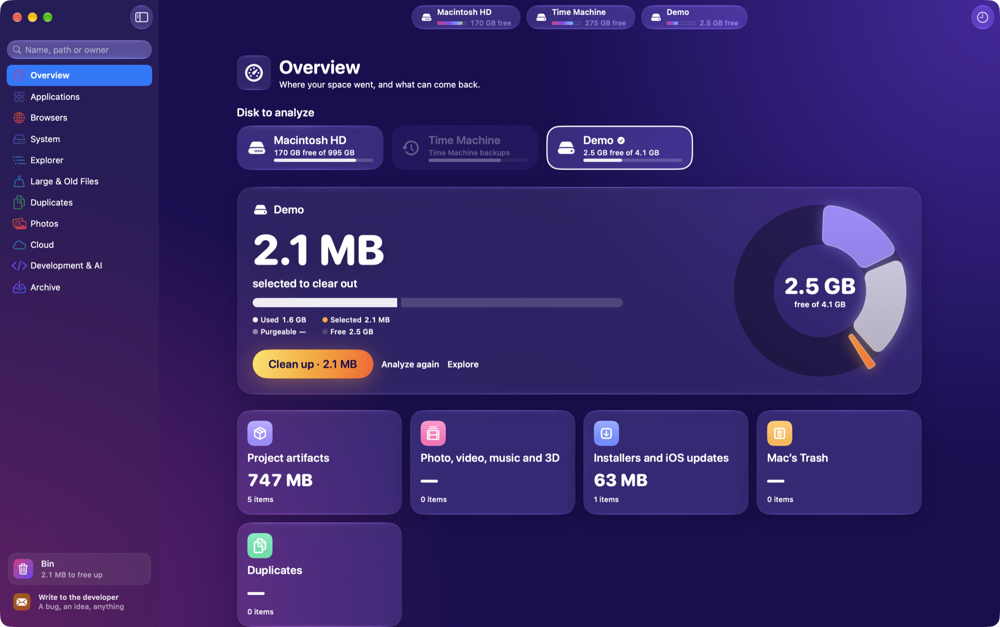
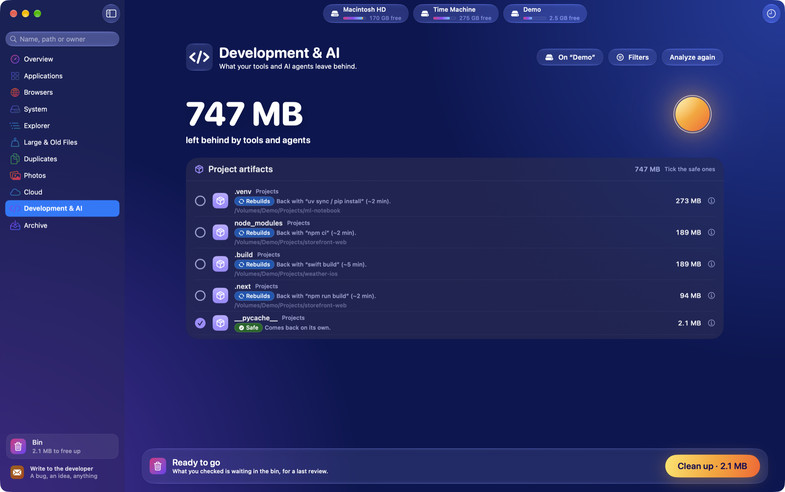
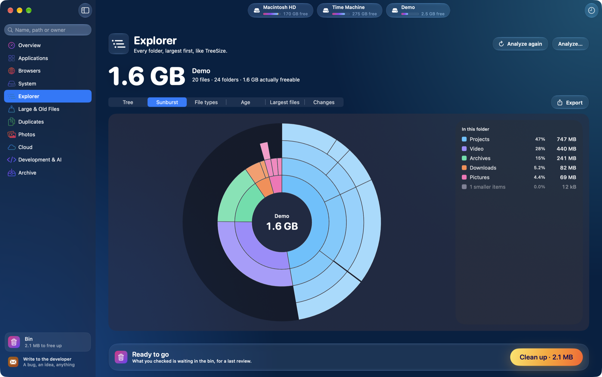
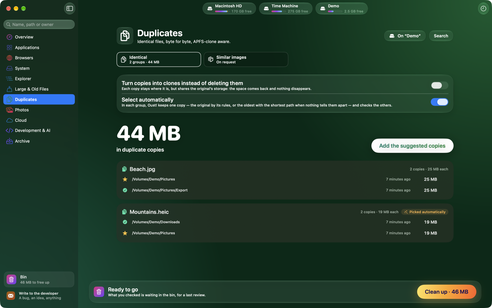
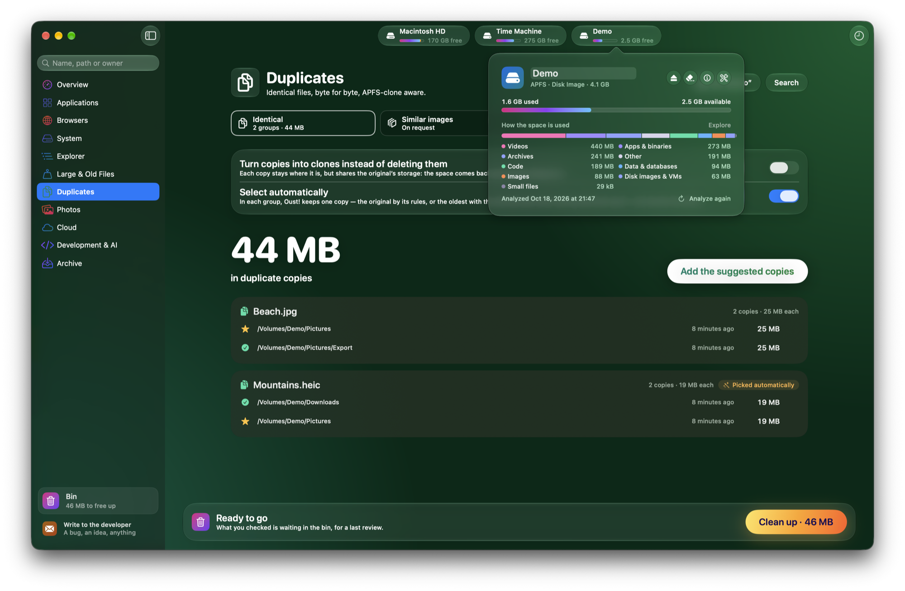
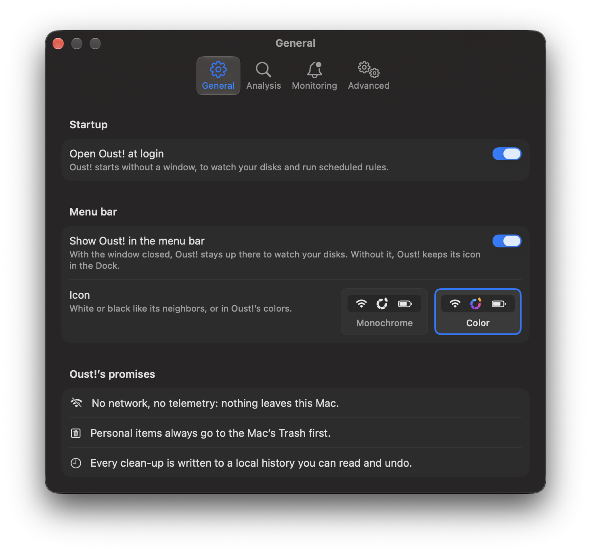

<p align="center">
  
</p>

<h1 align="center">Oust!</h1>

<p align="center">
  <strong>Clear out your Mac, safely.</strong><br>
  A native macOS app that shows where your disk space went, explains every item,
  lets you choose, and cleans up properly — with an honest report and a history you can undo.
</p>

<p align="center">
  macOS 26 · Apple Silicon & Intel · 100% offline · no telemetry
</p>



---

## Why Oust!

Most cleaners show a big flattering number, delete things for good, and phone home.
Oust! is built the other way round.

- **Honest numbers.** Oust! counts allocated size, not logical size; hard links and APFS
  clones are counted once; space held back by local Time Machine snapshots is shown
  separately. It only announces what will really come back.
- **The bin first.** Personal content goes to the Mac's Trash and into a history with its
  original path, so it can be restored. Only what rebuilds itself (caches, build artifacts)
  is removed on the spot.
- **Revalidated right before acting.** Every item is checked again just before it goes:
  it still exists, hasn't changed since the scan, no process is working in it, and its path
  passes a guard. When in doubt, the item is protected and Oust! says why.
- **Understands developer tools.** `node_modules`, `.build`, DerivedData, simulators,
  package caches, AI models, Claude Code and Codex histories and worktrees — with the
  rebuild cost of each item and automatic protection of anything with unique state
  (uncommitted changes, unpushed commits, a running process).
- **Nothing leaves your Mac.** No network, no analytics, no third-party dependency.

## Features

| | |
|---|---|
| **Overview** | Storage gauge with used, purgeable and selected space, one-click analysis of the startup disk or any other disk. |
| **Development & AI** | Project artifacts, Xcode, simulators, package caches, AI models, coding-agent leftovers, grouped by owner, each with its rebuild cost. |
| **Explorer** | Every folder from largest to smallest, a sunburst, file types, ages, largest files and growth since the last scan. |
| **Large & old files** | What you haven't opened in years, filtered by size and age. |
| **Duplicates** | Byte-for-byte duplicates that are aware of APFS clones (and can be turned into clones instead of deleted), plus similar images outside the Photos library. |
| **Photos** | Videos, screenshots, exact duplicates, similar shots and "useful" photos (receipts, labels, documents) through PhotoKit — never by opening the library package. |
| **Cloud** | The largest, oldest and duplicate files of iCloud Drive and File Provider services, read from the placeholders on your Mac, without downloading anything. |
| **System** | Local snapshots, the Trash, downloads, iOS backups, old Time Machine backups on a backup disk. |
| **Applications** | Uninstall with leftovers, and leftovers offered as soon as you drag an app to the Trash. |
| **Browsers** | Cache, history and cookies per profile, kept separate; never passwords. |
| **Disks** | One pill per mounted disk in the toolbar: free space, breakdown, rename, eject, format and partition external disks. |
| **Maintenance** | A scheduled check that tells you what can be recovered, a low-disk alert and a menu bar panel. |









<p align="center">
  <br>
  <em>The low-disk alert, a floating pill whose outline is the gauge.</em>
</p>

<p align="center">
  
</p>

## Install

1. Download the latest `Oust-x.y.z.dmg` from [Releases](../../releases).
2. Drag **Oust!** to **Applications** and open it.
3. Oust! works without Full Disk Access, and tells you what it can't see. To analyze
   Mail, Messages, Safari and the Trash too, grant it in **System Settings › Privacy &
   Security › Full Disk Access**.

## Safety model

Every item belongs to a safety class:

| Class | Meaning |
|---|---|
| **Safe** | Rebuilds itself or is clearly disposable. May be preselected. |
| **Rebuilds** | Comes back with a command or a download. Preselected only after a recency guard. |
| **Review** | Yours to decide (AI models, histories, downloads, similar duplicates). Never preselected. |
| **Protected** | Not selectable, with the reason shown. |

Deletion only ever goes through one module (`OustClean`), using the right tool when there is
one (`git worktree remove`, `xcrun simctl`, `tmutil`). The only deletion that bypasses the
Trash is formatting an external disk, behind its own guards (never an internal or startup disk,
disk name typed, nothing open on it). See [RULES.md](RULES.md).

## Build from source

Requirements: Xcode 27 and [XcodeGen](https://github.com/yonaskolb/XcodeGen)
(`brew install xcodegen`).

```bash
xcodegen generate && open Oust.xcodeproj
```

The Xcode project is generated from `project.yml` and is not versioned. Modules build and
test on their own:

```bash
Scripts/run-tests.sh   # every test target
Scripts/verify.sh      # lint, release build, tests, signed app build
Scripts/run-app.sh     # build and launch a signed development copy
```

Release build, signed with Developer ID, then the disk image:

```bash
Scripts/release.sh && Scripts/dmg.sh
```

### Architecture

| Module | Role |
|---|---|
| `OustCore` | Pure domain: items, sizes, safety classes, methods |
| `OustScan` | `getattrlistbulk` traversal, tree, accurate sizes, never leaving the volume |
| `OustVolume` | Volumes, capacities, snapshots, space reclaim |
| `OustSafety` | Path guard, running processes, git inspection |
| `OustRules` | Rule catalog and finders |
| `OustClean` | Deletion, history, restore |
| `OustDuplicates` | Duplicates aware of APFS clones, similar images |
| `OustPhotos`, `OustClouds`, `OustBrowsers`, `OustUninstall`, `OustWatch` | Photos, cloud, browsers, applications, maintenance |
| `OustModel` | Application state |
| `OustAgent` | `oust`, the command line and MCP server |
| `Feature*` | One section of the interface each |

## Command line & MCP

Coding agents leave `node_modules`, `.build`, DerivedData, worktrees and caches behind.
`oust` gives them Oust!'s engines — the same rules, the same revalidation, the same history —
as a command line tool and an MCP server that only talks over stdin/stdout.

```bash
mkdir -p ~/.local/bin && ln -sf /Applications/Oust.app/Contents/MacOS/oust-cli ~/.local/bin/oust
oust scan --json --path . --finders projectArtifacts
```

| Command | What it does |
|---|---|
| `oust scan [--json] [--finders NAME,…] [--path PATH]… [--limit N]` | Dry-run analysis: each item with its freeable size, safety class, method, rebuild cost and protections. Returns a preview token valid for 30 minutes. |
| `oust explain ID [--json]` | What it is, how it comes back, what Oust! will do, why it is protected. |
| `oust clean ID… [--token TOKEN] [--allow-review] [--dry-run] [--json]` | Cleans items shown by a recent scan, through `OustClean`. |
| `oust mcp` | MCP server on stdio with the `scan`, `explain` and `clean` tools. |

Register it with an MCP client, for example:

```bash
claude mcp add --scope user oust -- "$HOME/.local/bin/oust" mcp
```

```toml
# ~/.codex/config.toml
[mcp_servers.oust]
command = "/Users/you/.local/bin/oust"
args = ["mcp"]
```

Agents can only clean what a scan of the last 30 minutes showed, never anything protected,
never anything needing an administrator password, and "review" items only with
`--allow-review`. Everything goes into Oust!'s history.

## Privacy

Oust! makes no network connection, collects nothing and sends nothing. The only exception is
opt-in and per item: in the Photos preview, downloading an original from iCloud after you
confirm it — and that download is done by Photos, not by Oust!.

## License

Copyright © 2026 Daniel-Romain BLANC EI — BLANC-Conseil · [blanc-conseil.fr](https://blanc-conseil.fr)
