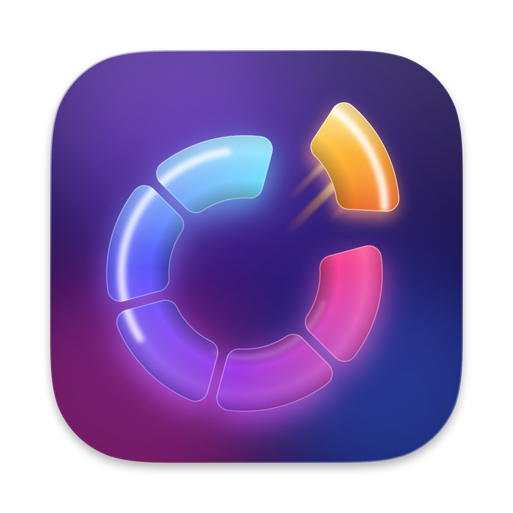

<p align="center">
  
</p>

<h1 align="center">Oust!</h1>

<p align="center">
  <strong>Understand your Mac's storage and battery.</strong><br>
  A free, native macOS app that shows where space went, explains what it finds,
  and keeps useful storage and battery information in the menu bar.
</p>

<p align="center">
  macOS 26+ · French &amp; English · local file analysis · no telemetry · GPL-3.0-only
</p>

<p align="center">
  <a href="https://github.com/Romain04240/Oust/releases/latest">Download Oust! for macOS</a>
</p>

## What to expect from 0.3.0

Oust! is still in active development. This release puts inspection, useful diagnostics
and clear action availability first. It is not a finished 1.0.

**Generic file cleanup is disabled in this release.** That includes direct removal of
caches and build artifacts, sending files to the Mac's Trash, restoring files, application
uninstalling, archive/transfer workflows, compression, APFS clone replacement, cloud
deletion or eviction, and Git worktree removal/pruning. Their inspection views remain
available. A size on disk is not a promise that Oust! can recover it.

Some dedicated operations remain available through `OustClean`, subject to their own
checks, tools and permissions. These include simulator removal, eligible tool-version
removal, Homebrew cleanup, supported local container operations, Firefox history,
PhotoKit actions and Time Machine operations. See [Supported actions](#supported-actions).

## Why Oust!

- **Useful numbers.** Allocated space, purgeable space, file classifications and APFS
  container measurements are kept distinct. Unknown measurements stay unknown.
  Shared blocks and snapshots can prevent a file's apparent size from becoming free space.
- **Review before acting.** Protected and unavailable actions stay blocked. Supported
  actions are revalidated before execution and recorded with their outcome.
- **A view of the whole Mac.** Storage exploration, developer tools, applications,
  browsers, Photos, cloud files and system diagnostics share one interface.
- **Two optional menu bar indicators.** Show storage, battery, both, or hide them.
  Each indicator opens its own compact panel, sized for its contents and the available screen.
- **Local analysis.** File analysis and recommendations run on the Mac, with no analytics
  and no file inventory sent to a server. Update checks happen only when requested.

## Storage and battery in the menu bar

The storage indicator shows available space and opens a compact disk panel. The battery
indicator has its own panel for charge, power source, remaining-time estimates, battery
health and available power readings.

Where macOS supplies them, Oust! shows cycle count, maximum capacity, temperature in
Celsius or Fahrenheit, voltage, current and charging information. Estimated power is
labelled as estimated. An unavailable reading is not replaced with a plausible number.

Supported device readings can include AirPods and other peripherals. Left earbud, right
earbud and charging case are separate when that information is available. Choose up to
six displayed devices, give them aliases, set their order and configure eligible low-battery
alerts. Mac battery alerts have their own low and charged thresholds.

Apple Watch values can be relayed through an already-paired iPhone when the connection
and identity checks allow it. They are labelled **Via iPhone**. Their collection time is
not a sensor measurement time, so relayed values are not used for threshold alerts.
Bluetooth and relay availability depend on the device, permissions and what macOS exposes.

## Explore and review

| Tool | What it provides in this release |
|---|---|
| **Overview** | A compact capacity chart, APFS details and cleanup findings. Opening Overview collects startup-disk findings once per session when needed, or reuses a completed analysis from this session. Automatic collection does not select or clean anything; other disks are analyzed on request. File classification has its own source date and explicit refresh. |
| **Guided review** | Twelve startup-disk steps: Applications, Browsers, System, Time Machine, Explorer, Large & old files, Duplicates, Photos, Cloud, Development & AI, Archive and Bin. Review, skip, pause or resume; finishing the guide does not start cleanup. |
| **Explorer** | Folder sizes, a sunburst, file types, ages, largest files, growth, document revision dates and CSV export. The CSV uses zero for gains from unavailable operations. |
| **Large & old files** | Size, age and file-kind filters over the scanned tree, with categories on a single scrollable row. Age information is explained in context. |
| **Development & AI** | Build artifacts, Xcode data, simulators, package caches, tool versions, AI models and coding-agent data, with ownership, rebuild information and protections. Git worktrees are inspection-only. |
| **Applications** | Installed-app inventory, usage filtering, architecture badges and associated-data inspection. Generic uninstall and leftover-file removal are unavailable. |
| **Browsers** | Profiles, caches, history and cookies kept separate. Unreadable Firefox inventory is distinguished from confirmed absence. Passwords, saved cards and bookmarks are not cleanup targets. |
| **Duplicates** | Exact-file duplicates and similar-image inspection, with APFS-sharing information. Generic file deletion and clone replacement are unavailable. |
| **Photos** | Videos, screenshots, exact duplicates, similar images and document-like photos through PhotoKit, without opening the library package directly. Local and cloud-only data are distinguished. |
| **Cloud** | Inspection of locally recorded File Provider/iCloud metadata and placeholders. No cloud account sign-in is required. File deletion and local-copy eviction are unavailable. |
| **System** | Read-only inspection of downloads, including protected incomplete Safari downloads, caches, user logs, preference diagnostics, account archives, iOS backups, virtual machines and other protected data. |
| **Login items** | A partial inventory of declared applications and helper components, with separate enabled/allowed states, alongside the existing targeted missing-path diagnostic. It does not prove what actually started. macOS Login Items settings remain the reference. |
| **Time Machine** | Local snapshots and their APFS measurements, retained-space explanations and guarded system-tool workflows. Backup-disk pruning has a separate protected path. |
| **Advice** | Expand a suggestion to inspect its items, rationale and available actions. Archive and transfer preparation remains blocked while Trash support is unavailable. |
| **Archive & Transfer** | Candidate/source and destination information. Preparing or starting their file-copy workflows is blocked while Trash support is unavailable. |
| **Disks** | Mounted-volume information, available capacity, rename and eject. External-disk formatting and partitioning have separate destructive-action guards. |
| **History & maintenance** | Outcomes, refusals and errors; low-disk alerts and configured maintenance checks. History restoration is unavailable. Scheduled actions remain subject to current capability and safety checks. |

Pin frequently used tools in the sidebar. Explanations sit beside the controls they describe,
while current errors and protections remain visible. Charts, selection feedback and page
transitions respect Reduce Motion.

Preference diagnostics do not reset settings automatically. User logs, account archives
and iOS backups stay in place, with no cleanup gain promised. The login inventory and
missing-path diagnostic are also inspection only; neither enables, disables or deletes
a declared login item.

## Supported actions

Availability is determined per item. A listed method is not permission to act on every
matching folder, and it does not guarantee a particular amount of recovered space.

- **Xcode simulators:** eligible devices and runtimes through `simctl`.
- **Developer tools:** eligible Python/Rust tool versions through their own tools,
  and Homebrew's cleanup command.
- **Local containers:** supported build-cache, image and container operations through
  the local engine. A remote Docker context is refused.
- **Firefox:** the dedicated history operation on an eligible closed profile through
  SQLite, preserving the separation from bookmarks.
- **Photos:** selected assets through PhotoKit and the macOS confirmation flow.
  Photos iCloud can propagate deletion to other devices. Recently Deleted delays
  when storage is recovered.
- **Time Machine:** selected local snapshots through `tmutil`, with explicit
  administrator authorization or the optional approved helper. Backup-disk operations
  use their own guarded workflow.

External-disk erase/partition operations are separate from the cleanup queue. They refuse
internal/startup disks and require explicit confirmation. They are destructive.

## Install and update

1. Download an `Oust-x.y.z.dmg` from [GitHub Releases](https://github.com/Romain04240/Oust/releases).
2. Drag **Oust!** to **Applications**, then open it from there.
3. Oust! explains locations it cannot read. Grant **Full Disk Access** in System Settings
   only if you want to inspect protected locations such as Mail, Messages or Safari.

Requires **macOS 26 or later**. Release packaging targets **Apple Silicon and Intel**;
the published installer's architecture details describe the delivered build. Building
both architectures is not the same as testing on both kinds of Mac.

**Check for Updates** is manual. Oust! checks GitHub for a stable release and can download
its matching DMG. Before opening it, the app checks the download size, SHA-256 when GitHub
provides a digest, and the publisher's Developer ID signature. Quit Oust! and replace the
app in Applications through Finder. There is no silent replacement or Sparkle updater.

The optional administrator helper is authorized through macOS. After its executable
changes, Settings offers an explicit repair. Oust! never stores an administrator password.

## Safety model

Cleanup candidates have a safety class. Their methods must also be available in the current build.

| Class | Meaning |
|---|---|
| **Safe** | Disposable or managed by a supported tool. May be preselected in a manual analysis. |
| **Rebuilds** | Reconstructable, with a recency guard before any manual preselection. |
| **Review** | Requires a choice; never preselected by the general safety policy. |
| **Protected** | Not selectable; known reasons are explained. |

Method availability is a separate check. Disabled methods stay blocked at any safety class.

Overview's automatic collection never preselects. Other views keep their explicit
selection policies; duplicate suggestions require the user's separate opt-in.

Supported actions pass through `OustClean`. They revalidate applicable paths, identity,
activity and tool-specific requirements before acting. A failed check protects or skips
the item. Stopping an Overview collection waits for its owned work to finish; late
results cannot replace a newer collection or restore a choice the user unchecked.

See [RULES.md](RULES.md) for the project rules. The current capability checks take
precedence over older descriptions of planned features.

## Build from source

Requirements: **Xcode 27**, Swift 6 and [XcodeGen](https://github.com/yonaskolb/XcodeGen).

```bash
brew install xcodegen
xcodegen generate
open Oust.xcodeproj
```

The project is generated from `project.yml` and is not versioned.

```bash
Scripts/run-tests.sh   # every test target
Scripts/verify.sh      # lint, release build, tests, signed app build
Scripts/run-app.sh     # build, verify signing, install and launch the development app
```

The supplied signing configuration and distribution scripts use the publisher's
Developer ID. Configure signing for your own team when building a fork. Changing the
app's signing identity can affect Full Disk Access and helper approval.

`run-app.sh` checks signature compatibility, keeps the previous installed app under
`build/PreviousInstalledApp.*`, and replaces `/Applications/Oust.app` before launching.
Signing a development build does not notarize it. The administrator helper requires
the exact app build to be notarized and stapled before approval or repair.

The release scripts build both `arm64` and `x86_64`, sign with Developer ID and package
the disk image. Notarization credentials must be configured.

```bash
Scripts/release.sh
Scripts/dmg.sh
```

For update discovery, publish a stable version tag such as `v0.3.0` with its matching
`Oust-0.3.0.dmg` asset. The bundled app version must match. Drafts and prereleases are
not accepted by the update checker. Verify the final package's architectures, signatures
and notarization before publication.

### Architecture

| Module | Role |
|---|---|
| `OustCore` | Items, sizes, safety classes and methods |
| `OustScan` | Disk traversal, trees and allocation measurements, bounded to the scanned volume |
| `OustVolume` | Volumes, capacity, APFS measurements and snapshots |
| `OustSafety` | Path, process and Git checks |
| `OustRules` | Rule catalog and finders |
| `OustClean` | Supported action execution, capability gates and outcome history |
| `OustDuplicates` | Exact duplicates, APFS-sharing awareness and similar images |
| `OustPhotos`, `OustClouds`, `OustBrowsers`, `OustUninstall`, `OustWatch` | Domain-specific inspection, supported operations and monitoring |
| `OustModel` | Shared application state and request ownership |
| `OustDeviceRelay` | Bounded local device-relay support |
| `OustAgent` | Command line and MCP interface |
| `Feature*` | SwiftUI screens |

## Command line & MCP

The bundled `oust-cli` exposes the same analysis, explanations, capability checks and
supported-action engine. It can run as a command line tool or an MCP server over stdio.
It does not bypass blocked file operations.

```bash
mkdir -p ~/.local/bin
ln -sf /Applications/Oust.app/Contents/MacOS/oust-cli ~/.local/bin/oust
oust scan --json --path . --finders projectArtifacts
```

| Command | Purpose |
|---|---|
| `oust scan [--json] [--finders NAME,…] [--path PATH]… [--limit N]` | Dry-run findings with measurements, safety, method, rebuild information and protections. Returns a preview token valid for 30 minutes. |
| `oust explain ID [--json]` | Explain a finding and its protections. |
| `oust clean ID… [--token TOKEN] [--allow-review] [--dry-run] [--json]` | Request supported actions from a recent scan, through `OustClean`. Unsupported methods remain refused. |
| `oust mcp` | Stdio server with `scan`, `explain` and `clean` tools. |

Example client configuration:

```bash
claude mcp add --scope user oust -- "$HOME/.local/bin/oust" mcp
```

```toml
# ~/.codex/config.toml
[mcp_servers.oust]
command = "/Users/you/.local/bin/oust"
args = ["mcp"]
```

Agents cannot act on protected findings or request administrator-only actions through
this interface. Review-class actions require `--allow-review`. A scan token and
revalidation do not make an unavailable method executable.

## Privacy

File analysis and recommendations stay local. Oust! sends no file inventory, telemetry
or analytics to a server and has no third-party library dependency.

Requested update checks and installer downloads contact GitHub. Optional device readings
can communicate over Bluetooth or with an already-paired iPhone over USB/local Wi-Fi.
These local device features are separate from disk analysis. Photos can download an
iCloud original for preview after your confirmation, through PhotoKit.

## License

Oust! is free software under the [GNU General Public License, version 3](LICENSE)
**(GPL-3.0-only)**. The interface is available in English and French.

Copyright © 2026 Daniel-Romain BLANC EI — BLANC-Conseil · [blanc-conseil.fr](https://blanc-conseil.fr)
